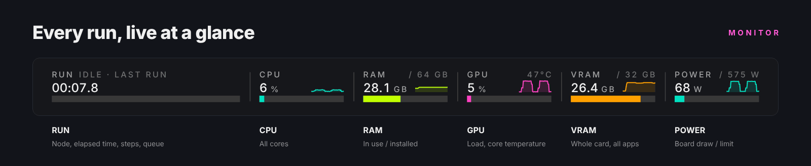
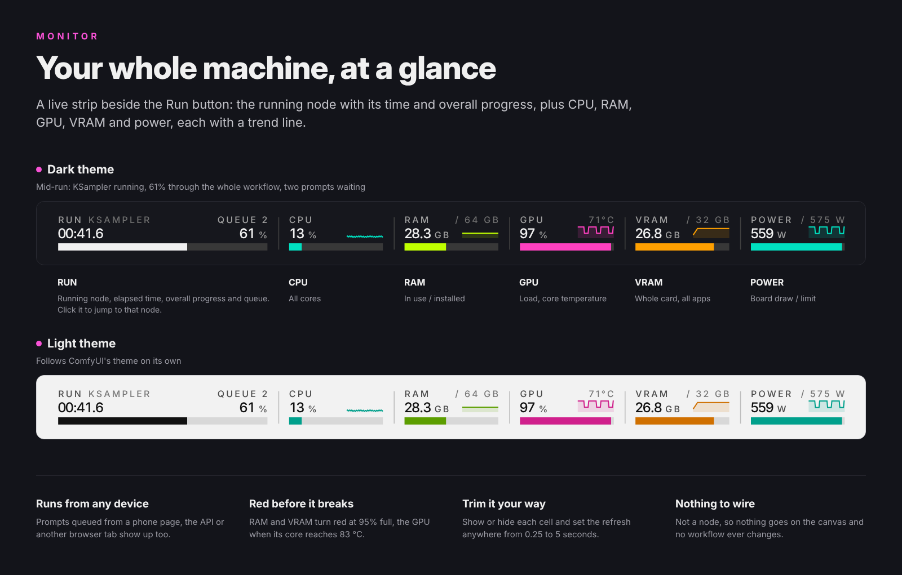
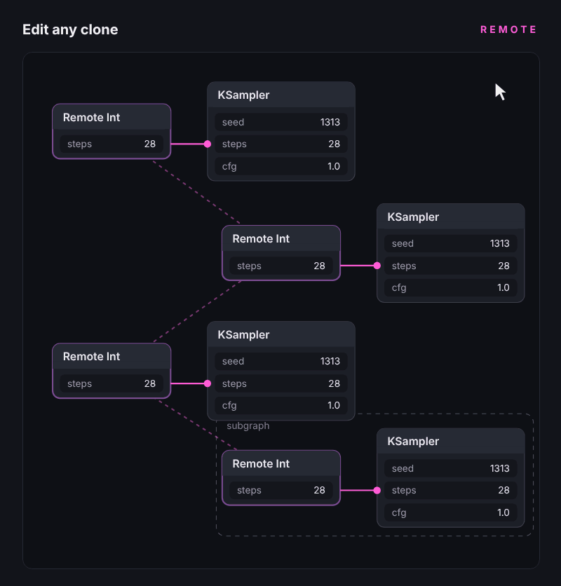
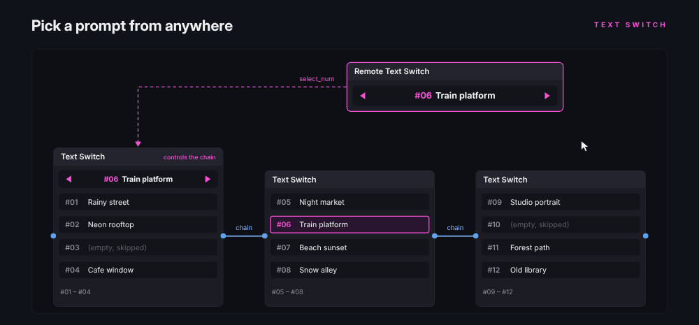
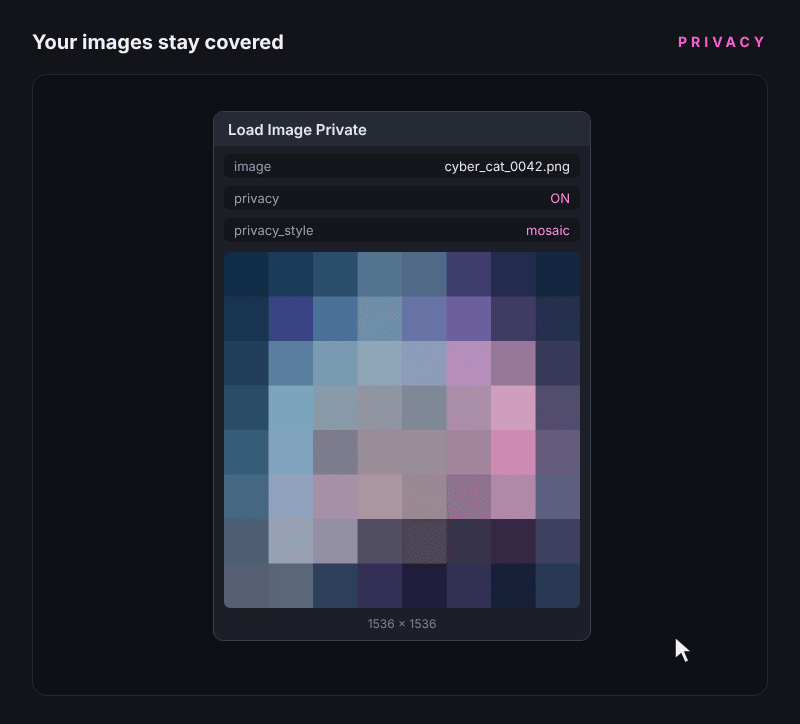

<p align="center"></p>

<p align="center"><a href="README.md">English</a> · <a href="README.zh-TW.md">繁體中文</a> · <a href="README.zh-CN.md">简体中文</a> · <b>日本語</b></p>

# ComfyUI-GeN13

画像から動画、人物ポートレートのワークフロー向けに作った ComfyUI カスタムノード集です。大きなワークフローのあちこちで同じ値を同期するリモートノード、連結できるプロンプト切り替え、プレビューを隠せる画像ノード、動画の時間方向の色合わせ、人物の美肌補正、Run ボタン横のリソースモニターを収録しています。

すべてのノードの表示名は **(GeN13)** で終わります。キャンバスをダブルクリックして `GeN13` と入力すると一覧できます。

## 特長

### Monitor:マシン全体を、ひと目で

Run ボタンの横に並ぶリアルタイムのモニターです。RUN には実行中のノード、経過時間、キュー全体の進捗、待機中のキュー数を表示し、スマホのページや API、別のブラウザタブから送ったキューも表示されます。進捗は同じワークフローの過去の所要時間から推定するので、ノードごとに飛ばず滑らかに進み、実行後も最後のバーが残ります。このページから実行した分はクリックでそのノードへ移動します。CPU、RAM、GPU、VRAM、電力はそれぞれ数値、推移グラフ、使用量バーを持ち、問題が起きる前に赤くなります(RAM と VRAM は 95%、GPU はコア温度 83 °C)。ノードではないので、キャンバスに置くものはありません。「設定 → GeN13 → リソースモニター」で各項目の表示と更新間隔を変えられます。

<p align="center"></p>

<p align="center"></p>

| GPU | 読み取れる項目 |
|---|---|
| NVIDIA(Windows、Linux) | 使用率、コア温度、VRAM、電力と電力上限(NVML / `nvidia-ml-py` 経由) |
| AMD(Linux) | 使用率、温度、VRAM、電力と電力上限(amdgpu ドライバから直接、追加インストール不要) |
| AMD または Intel(Windows) | 使用率と VRAM(タスクマネージャーと同じ Windows のカウンター)。温度と電力は Windows が公開していません |
| Apple シリコン、CPU のみ | RUN、CPU、RAM |

読み取れない項目は自動で非表示になり、空欄では表示しません。

### Remote:一度設定すれば、どこからでも操作

同じ値が必要な場所それぞれに Remote Int / Float / String / Boolean を置きます。`channel` 名が同じノードは分身となり、値、ステップ、バイパスがすべて同期します。どれか 1 つを変えると、サブグラフの中でも残りがすぐに追従します。1 つの Primitive からワークフロー全体に長い線を引く必要も、設定を探してスクロールする必要もありません。

<p align="center"></p>

<p align="center"></p>

### Text Switch:プロンプトを切り替え、いくつでも連結

タイトル付きの枠に直接プロンプトを入力し、選んだ 1 枠を出力します。chain で横に連結すれば枠数は無制限。番号は連結全体で続き、先頭のノード、またはキャンバスのどこかに置いた Remote Text Switch で枠を選びます。`auto next` はキューに送るたびに内容のある次の枠へ進み、選ばれた枠の上流だけが実行されます。先頭ノードには選択行 ‹ #07 タイトル › があり、長い連結でも選択中の枠がすぐ分かります(‹ › は空の枠をスキップ)。選択中の #NN をもう一度押すと折りたたみ、EXPAND ALL / COLLAPSE ALL は連結全体に効き、右クリック → Clear all boxes で 1 ノードを空にできます。chain 出力を空白へドラッグすると、次のノードが接続済みで追加されます。

<p align="center"></p>

<p align="center"></p>

### プライベート画像ノード:画面共有でも画像を見せない

Load、Save、Preview Image Private はノードのプレビューにモザイク、すりガラス、グラデーション、パレット、単色のカバーをかけられます。プレビューを長押しすると元画像が見えます。画像そのものは一切変更されないので、配信や画面共有も安心です。

<p align="center"></p>

<p align="center"></p>

### Color Match Temporal:画像から動画の色ずれを止める

生成した動画は再生が進むにつれて青っぽく、または暖色寄りになりがちです。Color Match Temporal は各フレームを先頭フレームの画像の色調に戻し、時間方向に平滑化するのでちらつきません。既定の `white balance` は色かぶりだけを補正し、明るさは元のまま。動いていない背景で色ずれを測るので、大きな白い服やアップの顔にもだまされません。カットが変わると、各ショットはそれぞれ自身の冒頭に合わせます。最後に `skin_anchor` が各フレームの肌色を参照画像の肌色へ合わせ、クローズアップ後に肌が赤く描き直される問題を直します。

<p align="center"></p>

### Degrease:肌はきれいに、パーツはそのまま

生成した人物画像や動画にありがちなテカリや過剰なディテールを取り除きます。シミ取り、美肌、テカリ除去、肌色補正、立体感軽減、色白肌(明るく冷たい肌色へ、唇の色は保持)の 6 種類で、それぞれ 0(オフ)から 100(最大)まで調整できます。目、まつ毛、眉、唇は自動で保護され、処理するのは肌だけです。

<p align="center"></p>

### 接続をもっと速く

リンクを空白に放すと、その接続先に合う GeN13 ノードが検索ボックスとリンクメニューの先頭に並び、リンクは本来つなぐべき入力に入ります(Trigger → Counter の `reset`、Remote Text Switch → Text Switch の `select_num`)。内蔵の Load / Save / Preview Image や Primitive を右クリックすると、設定と接続を保ったまま Private 版や Remote 版にその場で変換できます。どちらも「設定 → GeN13 → リンク」でオフにできます。

## インストール

**ComfyUI Manager**:`GeN13` で検索してインストール。

**手動**:

```bash
cd ComfyUI/custom_nodes
git clone https://github.com/heigen13/ComfyUI-GeN13
pip install -r ComfyUI-GeN13/requirements.txt
```

ComfyUI を再起動すれば使えます。追加のパッケージは `nvidia-ml-py`(NVIDIA 公式の NVML ライブラリ。モニターが NVIDIA カードの使用率、温度、電力を読むのに使います)の 1 つだけで、ComfyUI Manager が一緒にインストールします。手動インストールの場合は、上の `pip` の行を ComfyUI 自身の Python で実行してください(ポータブル版は `python_embeded\python.exe -m pip`)。それ以外は ComfyUI に含まれる torch、numpy、Pillow、psutil だけを使います。
オプション:**Resize** の `nvidia_rtx_vsr` には `nvidia-vfx` パッケージと RTX GPU が必要です。

**サンプルワークフロー**:Text Switch の連結、Remote による 2 段階生成、人物補正、動画の色合わせの 4 つを用意しました。ComfyUI の Templates パネルの ComfyUI-GeN13 から開くか、[`example_workflows`](example_workflows) を参照してください。

## ノード一覧

### 動画 / 色

| ノード | 内容 |
|---|---|
| **Color Match Temporal** | 生成動画の各フレームを参照画像(通常は先頭フレーム)に合わせ、時間方向に平滑化。`white balance` は色かぶりのみ補正、`mkl`、`reinhard` は明るさも合わせます。カットを自動検出し、`skin_anchor` で肌色を参照画像に戻します。`.cube` LUT も出力できます。 |
| **Degrease** | 画像と動画向けの人物補正:シミ取り、美肌、テカリ除去、肌色補正、立体感軽減、色白肌。各項目 0 でオフ。顔のパーツは保護され、処理は肌だけです。 |
| **Remote Video** | 先頭フレームを比率とメガピクセルでリサイズし、幅、高さ、秒数、FPS、MiniMax H3、Wan 2.1 / 2.2、LTX の有効なフレーム数を出力。channel が同じ分身は同期します。 |

### 画像

| ノード | 内容 |
|---|---|
| **Load Image Private** | プレビューにプライバシーカバーをかけられる Load Image。長押しで元画像を表示。幅と高さを出力し、ドラッグ&ドロップとアップロードに対応。 |
| **Save Image Private** | PNG、JPG、BMP、PNG + JPG で保存。接頭辞、連番の桁数、品質を設定でき、プレビューにも同じカバーをかけられます。 |
| **Preview Image Private** | 一時プレビュー(output には保存しません)、カバー対応。 |
| **Load Latest Image Private** | フォルダーから最新、最古、ファイル名順で画像を取得。ファイル名フィルター、サブフォルダー、連続読み込みに対応し、書き込み中のファイルはスキップします。 |
| **Load Image Orient** | Pillow だけでデコードする簡易読み込み。iOS のスクリーンショットが回転しません。 |
| **Load Image SD** | 画像を読み込み、A1111 / Forge の生成パラメーター(プロンプト、ネガティブ、シード、ステップ数、CFG、サンプラー、スケジューラー、サイズ、clip skip)を読み出して、ComfyUI で過去の画像を再現します。 |

### Latent

| ノード | 内容 |
|---|---|
| **Resize** | 1 つで潜在のサイズを決定:空の潜在の作成、画像のエンコード、既存の潜在のリサイズ。比率、幅と高さ、メガピクセルが連動し、crop / resize / pad / pad_edge / stretch、8〜64 の倍数に対応。画像 4 枚とマスクを同じ設定でリサイズできます。 |

### テキスト

| ノード | 内容 |
|---|---|
| **Text Switch** | 1 ノードに名前付き・折りたたみ可能なプロンプト枠を最大 25 個。連結すれば数は無制限。先頭ノードの選択行 ‹ ›、`auto next`、`select_num`(INT 入力)で選択を制御できます。右クリック → Clear all boxes で消去。 |
| **Text Concatenate** | 枠に入力したテキストを連結。枠ごとのオン / オフとソロに対応し、空の枠はスキップします。 |
| **Prompt Cache** | 上流のテキスト(LLM の台本など)をファイルに保存し、上流のモデルを読み込まずに再利用。自動バックアップ 1 世代とお気に入りを無制限に保持します。 |
| **Show Any** / **Show Any Lite** | どんな型も受け取り、表示してそのまま出力。切り取り、コピー、貼り付けボタン付きで、内容はワークフローと一緒に保存されます。 |

### ユーティリティとリモート

| ノード | 内容 |
|---|---|
| **Remote Int / Float / String / Boolean** | `channel` 名が同じ分身は値、ステップ、バイパスを同期(サブグラフ内も)。どれか 1 つに接続すると、その入力がグループ全体を動かします。 |
| **Remote Text Switch** | Text Switch のリモコン。選ばれた枠の番号とタイトルを表示し、‹ › は空の枠をスキップします。出力 `select_num` は Text Switch の `select_num` へ。`auto next` は Text Switch と同じ OFF / NEXT スイッチです。 |
| **Counter** | キューに送るたびにカウント。範囲、各数値の繰り返し回数、リセットボタン、リセット入力、毎時・毎日の自動リセットに対応。バイパス中は止まります。 |
| **Trigger** | ボタンか上流の変化で新しい値を出力。Counter の reset に接続します。 |
| **Number** | 1 つの数値を INT、FLOAT、STRING で同時に出力。小数から整数への変換方法を選べます。 |
| **Switch Any** | 任意の数の入力から番号で 1 つを選んで出力。型は自由で、選んだ入力だけが実行されます。`index` 出力で 2 つのスイッチを連動でき、各入力に名前を付けられます。 |

## 補足

- ノードの説明は英語が基本で、繁体字中国語、簡体字中国語、日本語の翻訳付き。ComfyUI の言語をいずれかに設定すると自動で切り替わります。
- ComfyUI 0.40 のクラシックキャンバス(Nodes 1.0)で開発・テストしています。画像プレビューは Nodes 2.0 にも対応。
- Remote と Text Switch の画像は説明用の図です。プライバシーカバー、Color Match、Degrease の例はノードの実際の出力、モニターの画像は実際のモニターにサンプルの値を表示したものです。

## サポート

GeN13 は無料です。ノードが役に立ったら、Ko-fi でコーヒーをおごっていただけるとうれしいです。

[](https://ko-fi.com/gen13)

## 免責事項

GeN13 は現状のまま提供され、いかなる保証もありません(GPL-3.0 第 15 条・第 16 条を参照)。使い方の責任は利用者にあり、お住まいの地域の法律を守ってください。違法なもの、著作権や肖像権を侵害するもの、本人の同意なく実在の人物を扱うものの作成や編集には使わないでください。プライバシーカバーは画面上のプレビューを隠すだけで、画像ファイルを暗号化したり保護したりはしません。

## ライセンス

Copyright (C) 2026 GeN's Studio Inc.

GNU General Public License v3.0(ComfyUI 本体と同じ)で公開しています。商用を含め、自由に使用、改変、共有できます。改変版を配布する場合は、同じく GPL-3.0 でソースコードを公開する必要があります。全文は [LICENSE](LICENSE) を参照してください。

`docs/` 内の画像 © 2026 GeN's Studio Inc.
