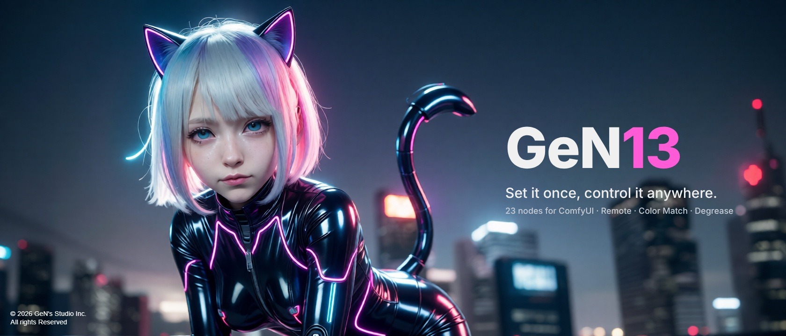
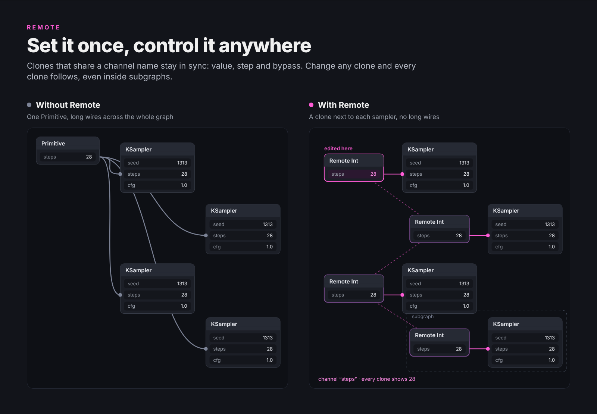
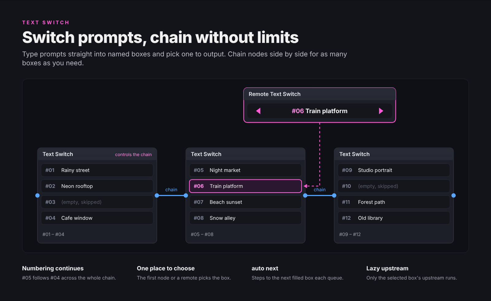
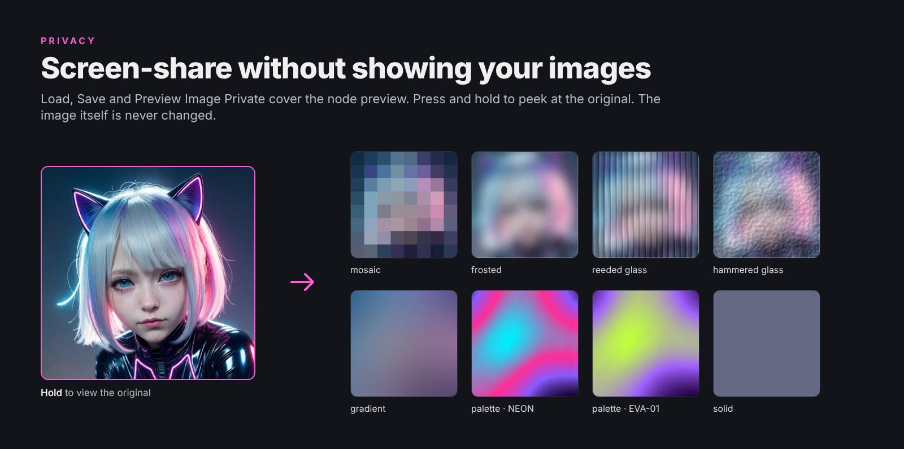
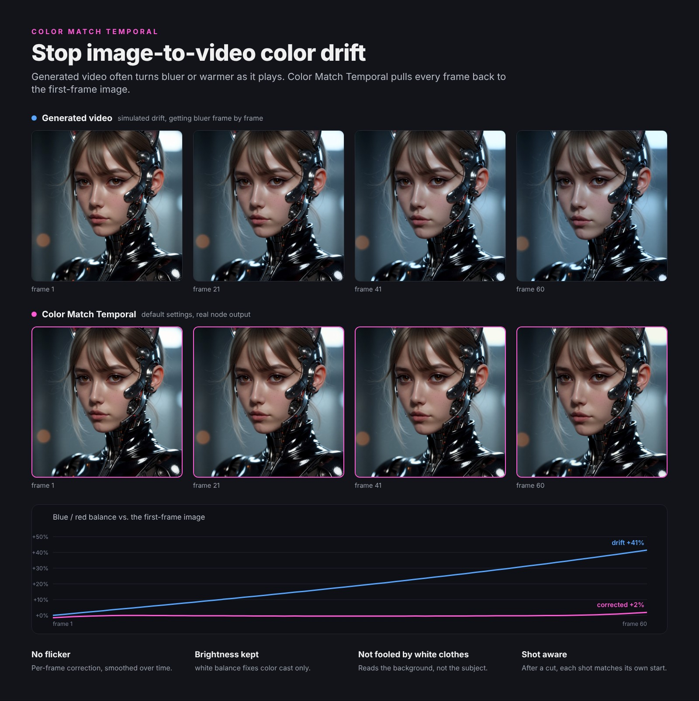
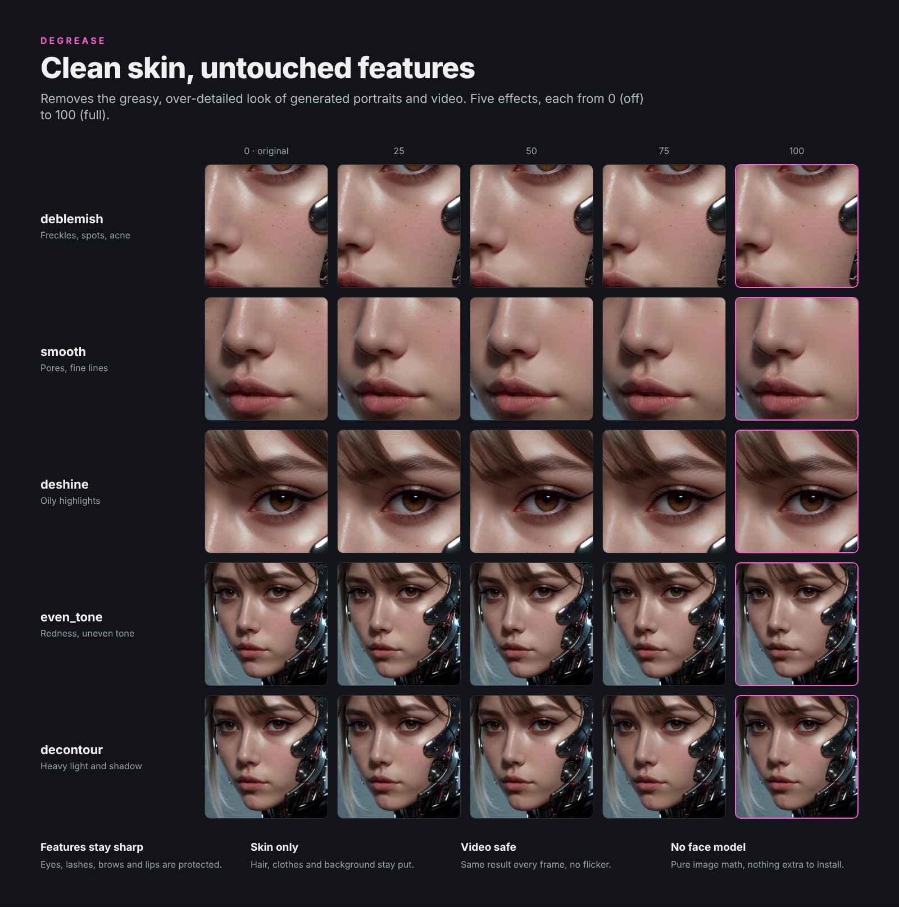

<p align="center"></p>

<p align="center"><a href="README.md">English</a> · <a href="README.zh-TW.md">繁體中文</a> · <b>简体中文</b> · <a href="README.ja.md">日本語</a></p>

# ComfyUI-GeN13

ComfyUI 自定义节点包，围绕图生视频与人像工作流设计：在大型工作流各处同步同一个数值的遥控节点、可串接的提示词切换、可遮住预览的图片节点、视频时间轴校色，以及人像美颜。

所有节点的显示名称都以 **(GeN13)** 结尾，在画布上双击、输入 `GeN13` 就能全部列出。

## 特色

### Remote：设一次，到处都能控制

在每个需要同一个数值的地方，各放一个 Remote Int / Float / String / Boolean。`channel` 名称相同的节点互为分身，数值、步进与 bypass 全部同步；改任何一个，其他分身立即跟着变，子图里也一样。不用再从一个 Primitive 拉长线横跨整个工作流，也不用滚回去找那一个设置。

<p align="center"></p>

### Text Switch：切换提示词，串接不限数量

直接在有标题的框里打提示词，选一框输出。多个并排用 chain 串接，框数不限；编号一路接续，由第一个或画布任何角落的 Remote Text Switch 选框。`auto next` 每次送出自动跳到下一个有内容的框，而且只有选中那一框的上游会运行。

<p align="center"></p>

### 隐私图片节点：屏幕共享不怕露图

Load、Save、Preview Image Private 的节点预览可以盖上马赛克、毛玻璃、渐变、色板或纯色，按住预览图才显示原图。图片本身完全不会被改动，直播或共享屏幕都安心。

<p align="center"></p>

### Color Match Temporal：修正图生视频的偏色

生成的视频常常越播越偏蓝或偏暖。Color Match Temporal 把每一帧拉回首帧图的色调，并沿时间轴平滑，不会闪烁。默认的 `white balance` 只修色偏、亮度照原片；它量的是画面中没动的背景，大面积白衣服或特写都骗不了它；换镜头后，每个镜头各自对齐自己的开头。

<p align="center"></p>

### Degrease：皮肤干净，五官不动

去除生成人像与视频常见的油腻感与过度细节。五种效果，每一种都从 0（关闭）到 100（全开）：去斑、磨皮、去油光、匀肤、减立体。眼睛、睫毛、眉毛、嘴唇自动保护，只处理皮肤。

<p align="center"></p>

## 安装

**ComfyUI Manager**：搜索 `GeN13` 安装。

**手动安装**：

```bash
cd ComfyUI/custom_nodes
git clone https://github.com/heigen13/ComfyUI-GeN13
```

重开 ComfyUI 即可，不需要另外安装套件，全部使用 ComfyUI 本身已有的 torch、numpy、Pillow。
选用：**Resize** 的 `nvidia_rtx_vsr` 缩放需要 `nvidia-vfx` 套件与 RTX 显卡。

## 节点一览

### 视频／色彩

| 节点 | 功能 |
|---|---|
| **Color Match Temporal** | 生成视频的每一帧对齐参考图（通常是首帧），并沿时间轴平滑。`white balance` 只修色偏；`mkl`、`reinhard` 连亮度一起对齐。自动检测换镜头，可输出 `.cube` LUT。 |
| **Degrease** | 图片与视频的人像美颜：去斑、磨皮、去油光、匀肤、减立体，各项 0 为关闭。五官自动保护，只处理皮肤。 |
| **Remote Video** | 首帧依比例与像素量缩放，输出宽、高、秒数、FPS，以及符合 MiniMax H3、Wan 2.1 / 2.2、LTX 的合法帧数；channel 相同的分身互相同步。 |

### 图片

| 节点 | 功能 |
|---|---|
| **Load Image Private** | 节点预览可盖隐私遮罩的 Load Image，按住预览图显示原图；输出宽高，支持拖放与上传。 |
| **Save Image Private** | 保存为 PNG、JPG、BMP 或 PNG + JPG，可设文件名前缀、流水号位数与质量，预览同样可盖遮罩。 |
| **Preview Image Private** | 预览图片（临时、不保存到 output），预览可盖遮罩。 |
| **Load Latest Image Private** | 从文件夹依最新、最旧或文件名取图，支持文件名筛选、子文件夹与连续多张，写入中的文件自动略过。 |
| **Load Image Orient** | 只用 Pillow 解码的简易载图，iOS 截屏不会被转向。 |
| **Load Image SD** | 加载图片并读出 A1111 / Forge 生成参数（提示词、负面提示词、种子、步数、CFG、采样器、调度器、尺寸、clip skip），在 ComfyUI 重现旧图。 |

### Latent

| 节点 | 功能 |
|---|---|
| **Resize** | 一个节点决定 latent 尺寸：创建空 latent、图片编码成 latent，或缩放既有 latent。比例、宽高、像素量三栏联动，支持 crop／resize／pad／pad_edge／stretch，对齐倍数 8～64，可同时缩放四张图与遮罩。 |

### 文字

| 节点 | 功能 |
|---|---|
| **Text Switch** | 每个节点最多 25 个可命名、可折叠的提示词框，串接后数量不限；`auto next` 与 `select_num`（INT 输入）可控制选框。 |
| **Text Concatenate** | 在框内打字并串接，各框可开关、可独奏，空白框自动略过。 |
| **Prompt Cache** | 把上游文字（如 LLM 写的脚本）保存为文件，之后不必加载上游模型就能重用；保留一代自动备份与不限数量的收藏。 |
| **Show Any** / **Show Any Lite** | 任何类型都能接，显示并直通输出；有剪切、复制、粘贴按钮，内容随工作流保存。 |

### 工具与遥控

| 节点 | 功能 |
|---|---|
| **Remote Int / Float / String / Boolean** | `channel` 名称相同的分身互相同步（数值、步进、bypass），子图里也一样；任意一个接线，就由该上游控制整组。 |
| **Remote Text Switch** | Text Switch 遥控器，显示选中框的编号与标题，◀ ▶ 自动略过空白框。 |
| **Counter** | 每次送出计数，可设范围、每个数字维持几次、按钮归零、上游归零，以及每小时或每天自动归零；bypass 时停住。 |
| **Trigger** | 按下按钮或上游改变时输出新值，接 Counter 的 reset。 |
| **Number** | 一个数字同时输出 INT、FLOAT、STRING，可选小数转整数的方式。 |

## 备注

- 节点说明以英文为主，附繁体中文、简体中文与日文翻译：ComfyUI 语言设为其中一种时自动切换。
- 在 ComfyUI 0.40 的经典画布（Nodes 1.0）开发与测试；图片预览也支持 Nodes 2.0。
- Remote 与 Text Switch 的图为示意图；隐私遮罩、Color Match、Degrease 的范例都是节点实际输出。

## 授权

Copyright (C) 2026 GeN's Studio Inc.

采用 GNU General Public License v3.0（与 ComfyUI 本体相同）。可以自由使用、修改、分享，也可以用于商业案子；但若散布修改过的版本，必须同样以 GPL-3.0 公开源代码。全文见 [LICENSE](LICENSE)。

`docs/` 内的图片 © 2026 GeN's Studio Inc.
